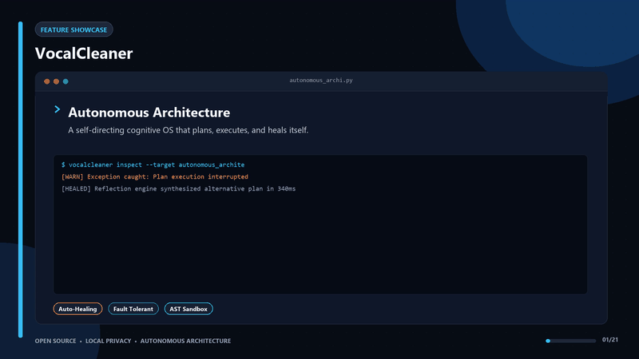

<div align="center">

[](https://nodejs.org)
[](https://expressjs.com)
[](https://cleanvoice.ai)
[](https://auphonic.com)
[](https://vocalcleaner.onrender.com/)

<h1>🎤 VocalCleaner</h1>
<h3>Your recording sounds like it was made in a bathroom. Fix it in 90 seconds.</h3>

<p><em>Dual-engine AI audio pipeline · CleanVoice denoise → Auphonic mastering · Broadcast-ready output</em></p>

**[🚀 Try VocalCleaner Live](https://vocalcleaner.onrender.com/)**

> ⚠️ Hosted on Render's free tier. First load may take 1–2 minutes while the server wakes up — then it's instant.

</div>

<div align="center">
  
</div>

---

## 🎯 What Problem Does This Solve?

Audio quality is the single most important factor in podcast and video production. Studies show listeners will tolerate average video but stop watching immediately for bad audio.

The problem: professional audio cleanup tools (Adobe Audition, iZotope RX) cost hundreds of dollars and take hours to learn. Generic one-click online tools run a heavy noise reduction pass that creates metallic artifacts and EQ distortion — you remove the noise but damage the voice.

**VocalCleaner** solves this with a precision two-stage pipeline:

1. **CleanVoice AI** performs surgical denoise — targeting only background hum, breath noises, and mouth clicks without touching the voice timbre
2. **Auphonic** then restores brightness, normalizes loudness to broadcast standard (-16 LUFS), and controls sibilance

The result is broadcast-ready audio from a raw, noisy recording — in 90 seconds, for free.

---

## 👥 Who This Is For

- **Podcasters** recording from home who want studio-quality output without expensive equipment
- **YouTubers** who record voiceovers in imperfect acoustic environments
- **Online educators** who need clean, professional audio for video courses
- **Remote workers** on video calls who want to clean up recordings before sharing
- **Node.js developers** studying async API orchestration with external AI services

---

## ⚡ Key Benefits

- **No software to install:** Runs in your browser — upload, wait, download
- **No metallic artifacts:** The two-stage approach applies the right tool at the right stage, preventing destructive EQ distortion
- **Broadcast standard output:** -16 LUFS loudness normalization matches the spec for YouTube, Spotify podcasts, and broadcast TV
- **Adjustable intensity:** Choose Light, Medium, or Aggressive noise reduction based on your recording environment
- **Asynchronous processing:** Upload and get a job ID — the app polls status without blocking your browser

---

## 🔬 The Dual-Engine Pipeline

Rather than running a generic double-filter pass that creates artifacts, VocalCleaner applies each AI at the stage where it excels:


### Phase 1: CleanVoice AI (Surgical Denoise)
- Removes background hum, breath noise, and mouth clicks
- Auto-EQ and normalizations are **deliberately disabled** in this phase to prevent compression artifacts
- Natural voice timbre is preserved

### Phase 2: Auphonic (Studio Mastering)
- High-frequency EQ recovery (3–8 kHz) — restores brightness removed during noise cancellation
- Adaptive volume leveling — smooths vocal volume spikes
- De-essing — controls sharp sibilance (`s` and `sh` sounds)
- Loudness normalization to -16 LUFS (broadcast standard)
- De-noise gate kept **off** in this phase to prevent choppy silence gaps

---

## 🛠️ Technical Architecture

```
VocalCleaner Backend (Node.js + Express)
│
├── Upload Handler
│   ├── Receives audio file upload (MP3/WAV)
│   └── Writes to disk (protects RAM from large files)
│
├── CleanVoice Integration
│   ├── Submits file to CleanVoice API
│   ├── Returns unique editId to client
│   └── Client polls /api/status/:editId for completion
│
├── Auphonic Integration
│   ├── Receives CleanVoice output
│   ├── Creates Auphonic production with configured presets
│   └── Waits for broadcast mastering completion
│
└── Proxy Downloader
    ├── Traces redirects to Auphonic S3 bucket
    ├── Bypasses browser CORS policies
    └── Returns final audio file to client
```

**Tech Stack:**
- **Backend:** Node.js · Express · Multer (file handling)
- **AI Services:** CleanVoice API (denoise) · Auphonic API (mastering)
- **Frontend:** Vanilla JS · CSS3 · Intensity slider controls
- **Deployment:** Render (live at vocalcleaner.onrender.com)
- **Security:** All API credentials via environment variables

---

## 🚀 Run Locally

### Prerequisites
- Node.js v18+

### Setup & Launch

```bash
git clone https://github.com/oguzemirtopuz/VocalCleaner.git
cd VocalCleaner
npm install
```

Create a `.env` file with your API credentials:
```env
CLEANVOICE_API_KEY=your_cleanvoice_api_key_here
AUPHONIC_USER=your_auphonic_username_here
AUPHONIC_PASS=your_auphonic_password_here
PORT=3456
```

```bash
npm start
# → http://localhost:3456
```

Get free API keys: [CleanVoice](https://cleanvoice.ai) · [Auphonic](https://auphonic.com)

---

## 🗺️ Roadmap

- [ ] Drag-and-drop file upload UI
- [ ] Batch processing (multiple files in one session)
- [ ] Output format selection (MP3, WAV, FLAC)
- [ ] Custom LUFS target (podcast vs. broadcast vs. streaming)
- [ ] Before/after waveform comparison

---

## 🤝 Contributing

Contributions welcome. Priority areas:
- Additional audio processing stages (room reverb removal)
- Better status polling UX (progress bar instead of spinner)
- Mobile-responsive UI improvements

---

## 📄 License

MIT License — see [LICENSE](LICENSE) for details.

---

<div align="center">
  <sub>Built by <a href="https://github.com/oguzemirtopuz">Oğuz Emir Topuz</a></sub>
  <br/>
  <sub>⭐ If this gave your voice professional quality, star the repo.</sub>
</div>
